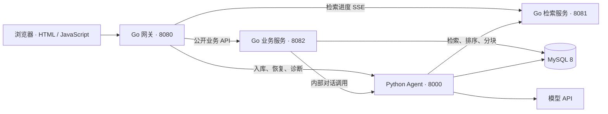

# AI 客服与工单助手

面向软件售后支持的 Go 后端项目。用户可以询问产品问题、查看回答引用的原文，并在自助排查未解决时提交工单。客服可在后台处理工单，管理员可更新知识库和检索配置。

## 核心功能

- **知识问答**：Agent 根据问题检索产品资料、调用工具并给出排查建议。回答支持来源回查与 SSE 流式输出。
- **订单与服务范围**：根据产品版本、服务期和功能判断客户可获得的支持。
- **工单闭环**：支持草稿确认、回复、状态流转和转人工。转交时保留问题、已尝试的步骤和相关证据，并记录操作时间线。重复提交按幂等键处理。
- **知识库管理**：支持文本入库、检索诊断和中断恢复。入库通过租约、心跳和任务记录管理 `parsed → chunked → stored` 各阶段。

## 架构



| 模块 | 技术 | 职责 |
| --- | --- | --- |
| [go-gateway](go-gateway/) | Go | 提供前端静态页面、API 路由、反向代理、入口限流和健康检查 |
| [go-business](go-business/) | Go | 处理注册登录、令牌、对话与会话持久化、订单、工单、知识库查询和检索设置 |
| [go-retrieval](go-retrieval/) | Go | 执行 BM25、向量与关键词召回融合、排序、MMR 去冗余和入库分块 |
| [backend](backend/) | Python 3.12、FastAPI、SQLAlchemy | 编排 Agent 和模型调用，执行知识入库、租约续期、恢复与诊断 |
| [frontend](frontend/) | HTML、CSS、JavaScript | 提供客户工作台、工单后台、知识库和检索设置页面 |
| [alembic](alembic/) | Alembic、MySQL 8 | 管理 Go 与 Python 共用的数据库结构，SQLite 可用于本地调试和测试 |

公开业务接口固定路由到 Go。Python 的 Agent 接口通过内部令牌鉴权，由 Go 业务服务调用。Python 调用 Go 检索计算失败时仍可以使用本地实现。

## 快速开始

需要 Docker 和 Compose 插件。以下命令在仓库根目录运行。

1. 在项目根目录的 `.env` 中设置共享的 JWT 密钥与 Agent 内部令牌。两个值分别生成，且每次重新启动时沿用已有值。

   ```bash
   openssl rand -hex 32
   openssl rand -hex 32
   ```

   ```dotenv
   AI_NEW_JWT_SECRET=<第一条命令的输出>
   AGENT_INTERNAL_TOKEN=<第二条命令的输出>
   ```

2. 配置对话模型。首次配置时复制 [模型配置示例](backend/.env.example)，然后在 `backend/.env` 中填写 `DEEPSEEK_API_KEY`。已有该文件可直接编辑。默认使用关键词检索。启用混合检索时，将 `RETRIEVAL_MODE` 设为 `hybrid`，并单独配置 `EMBEDDING_BASE_URL`、`EMBEDDING_API_KEY` 和 `EMBEDDING_MODEL`。

   ```bash
   cp -n backend/.env.example backend/.env
   ```

3. 构建并启动。Python 容器会先执行 Alembic 迁移，Go 业务服务在 Python 健康检查通过后启动。

   ```bash
   docker compose up -d --build --wait
   docker compose ps
   curl -fsS http://127.0.0.1:8080/health
   ```

4. 打开 [客户工作台](http://127.0.0.1:8080/)。管理员可访问 [工单后台](http://127.0.0.1:8080/admin)、[知识库](http://127.0.0.1:8080/knowledge)和[检索设置](http://127.0.0.1:8080/settings)。首次启动会初始化演示数据，演示账号见 [backend/seed.py](backend/seed.py)。

### 常用配置

| 配置 | 位置 | 用途 |
| --- | --- | --- |
| `AI_NEW_JWT_SECRET` | 根目录 `.env` | Go 与 Python 共用的 JWT 签名密钥 |
| `AGENT_INTERNAL_TOKEN` | 根目录 `.env` | Go 调用 Python Agent 时使用的内部令牌 |
| `MYSQL_DATABASE`、`MYSQL_USER`、`MYSQL_PASSWORD`、`MYSQL_ROOT_PASSWORD` | 根目录 `.env` | MySQL 初始化配置，适用于新建的数据卷 |
| `MYSQL_PUBLISHED_PORT` | 根目录 `.env` | 宿主机连接 MySQL 的端口，默认 `3307`。容器之间使用 `mysql:3306` |
| `DEEPSEEK_API_KEY`、`DEEPSEEK_BASE_URL`、`DEEPSEEK_MODEL` | `backend/.env` | 对话模型 API 配置 |
| `RETRIEVAL_MODE` | `backend/.env` | `keyword` 使用关键词检索，`hybrid` 启用混合检索 |
| `EMBEDDING_BASE_URL`、`EMBEDDING_API_KEY`、`EMBEDDING_MODEL` | `backend/.env` | 独立的 HTTPS E5 向量服务 |

排查启动问题时，用 `docker compose logs --tail=100 gateway go-business backend go-retrieval mysql` 查看各服务日志。网关在线但上游异常时，`/health` 可能仍返回 HTTP 200，需同时检查响应中的状态和上游信息。

仓库中的 Compose 配置包含本地调试端口，并开启了网关 pprof。部署到公网前，请关闭 pprof、限制内部服务端口的访问范围，并更换演示账号口令和数据库默认密码。

## xwp.xwd.info 自动部署

推送到 `main` 后，[部署工作流](.github/workflows/deploy-xwp.yml)会按提交 SHA 构建四个应用镜像，传到部署服务器并替换对应容器。MySQL 数据和检索配置保存在独立数据卷。部署会检查网关与上游服务的健康状态，失败时尝试恢复上一版应用镜像。

上线入口为 [xwp.xwd.info](https://xwp.xwd.info/)。Nginx 负责 HTTPS，网关只绑定宿主机回环地址的 `2080` 端口。服务器上的部署配置在 `/opt/ainew-xwp/.env`，模型配置在 `/opt/ainew-xwp/backend/.env`。GitHub Actions 使用 `XWP_DEPLOY_KEY` 和 `XWP_KNOWN_HOSTS` 连接部署服务器。

线上 Embedding 通过 SSH 隧道访问远端服务。Python 容器通过只读挂载的 Unix Socket 连接宿主机的隧道，并使用服务证书验证 TLS。部署主机的 Socket 中继由 [systemd 单元](deploy/ainew-embedding.socket)维护，`EMBEDDING_CA_FILE` 和 `EMBEDDING_SOCKET` 配置见 [环境变量示例](backend/.env.example)。

## 从 SQLite 导入 MySQL

先停止旧应用的写入并备份 SQLite 文件。目标 MySQL schema 应为空，先建表、再导入，最后启动应用，以避免种子数据占用目标表。以下命令假设已按测试章节创建并激活 Python 虚拟环境，且使用 Compose 的默认本地连接参数。

```bash
docker compose up -d --wait mysql
DB_DRIVER=mysql python -m alembic upgrade head
DB_DRIVER=mysql python -m scripts.import_sqlite_to_mysql /path/to/old-app.db
docker compose up -d --build --wait
```

如修改过 MySQL 配置，宿主机执行迁移时也要设置相应的 `MYSQL_HOST`、`MYSQL_PORT`、`MYSQL_DATABASE`、`MYSQL_USER` 和 `MYSQL_PASSWORD`。这里的 `MYSQL_PORT` 对应 Compose 的 `MYSQL_PUBLISHED_PORT`。如已导出旧的 `DATABASE_URL`，请先清除或改为目标 MySQL 连接，因为该变量优先于 `DB_DRIVER`。

## 开发与测试

Go 模块和 CI 使用 Go 1.27.3，Python CI 使用 3.12。以下命令从仓库根目录执行，无需启动整套 Compose 服务。HTTP 测试会在本机回环地址启动独立进程。

```bash
# Go 服务与竞态检查
(cd go-gateway && go test -race ./...)
(cd go-business && go test -race ./...)
(cd go-retrieval && go test -race ./...)

# Python Agent、入库、恢复与诊断等测试
python3.12 -m venv .venv
source .venv/bin/activate
python -m pip install -r backend/requirements-dev.txt
PYTHONPATH="$PWD" python -m pytest backend/tests -q
```

[CI 工作流](.github/workflows/ci.yml)分别运行三个 Go 模块、Python 测试和知识入库重启恢复测试。重启恢复测试在 CI 中单独作为观察性任务运行。

## 更多文档

- [API 概览](docs/api.md)、[认证](docs/auth-api.md)、[订单](docs/orders-api.md)、[工单](docs/tickets-api.md)
- [Go 网关](go-gateway/README.md)、[Go 业务服务](go-business/README.md)、[Go 检索服务](go-retrieval/README.md)
- [检索评测方法与结果](docs/retrieval-evaluation.md)
